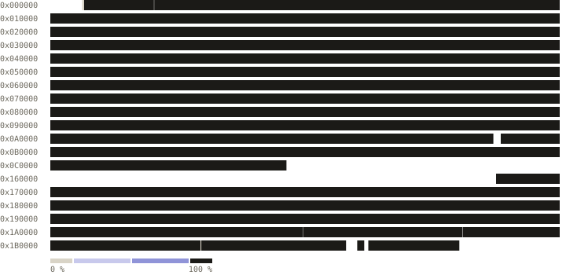

# Turok: Rage Wars decompilation

A matching decompilation of *Turok: Rage Wars* for the Nintendo 64.

> **This repository contains no game content.** You must supply a legally acquired cartridge dump. Builds are verified against its SHA256.

## Progress

<!-- progress -->
<pre><code>all      [███████████████████░]  99.80% (~99.99%)  41,860,287 of 41,943,040 bytes, linker fill 436 bytes, unknown 837 bytes</code> <code>de       [███████████████████░]  99.12% (~99.99%)  8,315,051 of 8,388,608 bytes, linker fill 184 bytes</code> <code>eu       [███████████████████░]  99.99%  8,388,484 of 8,388,608 bytes, linker fill 76 bytes, unknown 48 bytes</code> <code>eu-x     [███████████████████░]  99.89% (~99.99%)  8,379,668 of 8,388,608 bytes, linker fill 44 bytes, unknown 789 bytes</code> <code>us       [███████████████████░]  99.99%  8,388,544 of 8,388,608 bytes, linker fill 64 bytes</code> <code>us-rev1  [███████████████████░]  99.99%  8,388,540 of 8,388,608 bytes, linker fill 68 bytes</code></pre>

| de (NUS-NRWD-0, Germany). Censored German release. SHA256 `9dc401252bacb2ad7412ef003f97f28cb225d76b3cc76f430fbc27fa05067ca8` |
|---|
| <pre><code>code      [████████████████████]  100.00%  1,109,460 of 1,109,460</code> <code>data      [████████████████████]  100.00%  254,998 of 254,998</code> <code>functions [████████████████████]  100.00%  4,249 of 4,249</code> <code>blobs     [███████████████████▒]  98.94% (~100.00%)  6,914,305 of 6,987,678</code></pre> |

| eu (NUS-NRWP-0, Europe). PAL release. SHA256 `d763cbbe485a5f9e1b7be97d5ac16735087e23d0bb62c05dc844e01b7e1156d1` |
|---|
| <pre><code>code      [████████████████████]  100.00%  1,114,888 of 1,114,888</code> <code>data      [████████████████████]  100.00%  347,212 of 347,212</code> <code>functions [████████████████████]  100.00%  4,254 of 4,254</code> <code>blobs     [████████████████████]  100.00%  6,906,192 of 6,906,192</code></pre> |

| eu-x (NUS-NRWX-0, Europe). PAL multi-language release. SHA256 `511f6c876586bf401faf01a270c67f26fcb7db55ed3f35759c71ab15a29de750` |
|---|
| <pre><code>code      [████████████████████]  100.00%  1,115,612 of 1,115,612</code> <code>data      [████████████████████]  100.00%  251,956 of 251,956</code> <code>functions [████████████████████]  100.00%  4,256 of 4,256</code> <code>blobs     [███████████████████▒]  99.88% (~100.00%)  6,991,908 of 7,000,015</code></pre> |

| us (NUS-NRWE-0, North America). First NTSC release (black cartridge). SHA256 `0433043aaba2649bdd1fe717c4020550ac663c0362527aa082490f5977a3e46b` |
|---|
| <pre><code>code      [████████████████████]  100.00%  1,160,704 of 1,160,704</code> <code>data      [████████████████████]  100.00%  208,136 of 208,136</code> <code>functions [████████████████████]  100.00%  4,325 of 4,325</code> <code>blobs     [████████████████████]  100.00%  6,999,512 of 6,999,512</code></pre> |

| us-rev1 (NUS-NRWE-1, North America). Revised NTSC release (grey cartridge). SHA256 `5dfbae59e4a3860b740ccbb28f33aad624315e30bfca6d60abd62d12a89e0089` |
|---|
| <pre><code>code      [████████████████████]  100.00%  1,132,592 of 1,132,592</code> <code>data      [████████████████████]  100.00%  237,616 of 237,616</code> <code>functions [████████████████████]  100.00%  4,355 of 4,355</code> <code>blobs     [████████████████████]  100.00%  6,998,140 of 6,998,140</code></pre> |
<!-- /progress -->

`unbake sync` writes the block above from `progress.json`; every figure is measured against the five ROMs on each sync.

- **ROM line**: matched code, matched data, decoded blobs and the cartridge header, as a share of the 8 MiB ROM. Linker
  fill (the linker's alignment padding) and unknown bytes (ROM spans no class holds) are shown beside it and are not
  part of it. `(~x%)` also counts fuzzy code and data and blobs only identified, not decoded.
- **code / data**: bytes of the text and data sections that a source compiles to exactly. Hand-written SDK assembly
  (`.s`, 44 to 45 functions per version) is counted as matched.
- **functions**: functions whose bytes match, of all functions in the version.
- **blobs**: non-code ROM content listed in `config/blobs.toml`; decoded rows over all blob bytes. A decoded row is
  either typed (audio, graphics, model, world, text, fill, stale data) or a `leftover` copy: raw bytes held exactly,
  with no type yet. `progress.json` counts the leftover bytes as `untyped`: de 124,824 (559 rows), eu 600,694
  (1,340), eu-x 681,115 (1,401), us 709,351 (73), us-rev1 649,204 (45). A blob line at 100% still holds these.

The game sources live in the original object-file layout under `SOURCE/` (the paths the debug symbols name); there is
no `src/`. `find SOURCE -type f | wc -l` gives 2,955 files, each its own translation unit: several units under one
object directory (for example `SOURCE/AI/ENEMIES/TURRETAI/`) are later merged into that object as plain source work.

## Development & Contributions

Contributions and corrections are welcome. Run `make check` before opening a pull request.

For detailed instructions please see [CONTRIBUTING.md](CONTRIBUTING.md).

## License

[CC0 1.0](LICENSE)

## Dependencies

<!-- dependencies -->
- [GCC 2.8.1](https://github.com/pmret/gcc-papermario)
- [abumas](https://github.com/AbuN64/mas-n64)
<!-- /dependencies -->

